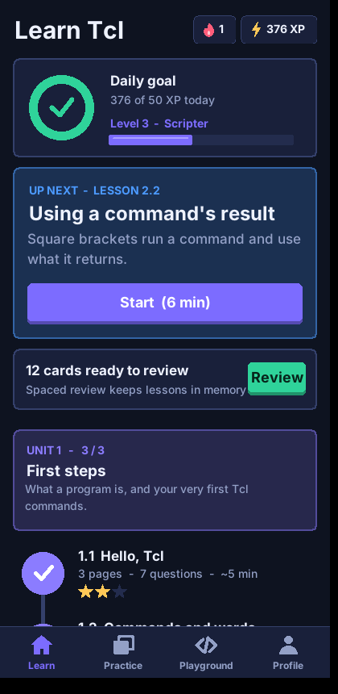
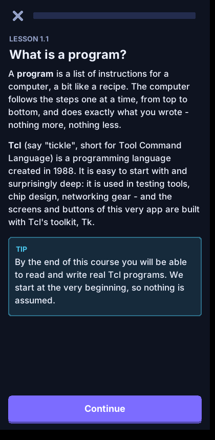
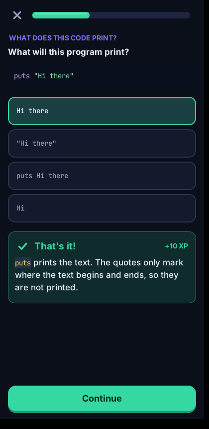

# Learn Tcl

A modern, touch-friendly app that teaches **Tcl from absolute zero to expert level** -
and is itself written **entirely in Tcl/Tk** (about 3,000 lines of Tcl plus the course).

  

* **38 lessons in 11 units**: from "what is a program?" to coroutines, TclOO, safe interpreters and Tk
* **328 questions** in six types: multiple choice, *predict the output*, fill-the-blanks, order-the-lines, typed answers, and *write real code* (checked by actually running it)
* **152 flashcards** with an SM-2 spaced-repetition scheduler (Again / Hard / Good / Easy); questions you miss become flashcards automatically
* **Daily practice** that interleaves old material and favours your weak spots, plus a 2-minute quick quiz
* **Playground**: a real, sandboxed Tcl interpreter with a symbol keypad for typing code on a phone
* Smooth, anti-aliased visuals: icons, rounded corners and progress rings are rasterised at runtime (`lib/aa.tcl`), because plain Tk canvas shapes are jagged
* **Unit tests / test-out**: score 80% on a 10-question unit test to skip ahead; **text-size setting**, **tablet/landscape** column layout, Android **back button** support, forgiving typed answers, WCAG-checked colours in both themes
* XP, streaks, daily goal, levels, stars, light and dark themes; progress saved on the device
* **Trustworthy content**: an automated test runs every code example in the course and checks the output shown

How the design follows learning science: [docs/PLAN.md](docs/PLAN.md).

## Run it

**On a computer** (needs Tcl/Tk 8.6 - `sudo apt install tcl tk`, or `brew install tcl-tk`, or the ActiveTcl/Magicsplat installer on Windows):

```
wish main.tcl
```

**On an Android phone**: see [docs/ANDROID.md](docs/ANDROID.md). Short version: install
**AndroWish** (the Tcl/Tk runtime for Android) and open the single file
[`dist/learn-tcl.tcl`](dist/learn-tcl.tcl).

## Tests

```
tests/all.sh      # content, scheduler, storage, every lesson through the real UI, and the bundle
```

* `tests/run.tcl` - runs all 328 exercises' answers and every code block on every page in the sandbox
* `tests/ui_smoke.tcl` - drives the real widgets under a virtual display, solves every exercise type, writes optional screenshots (`SHOTS=dir`)
* `tests/bundle_test.tcl` - the one-file bundle works with no other files present

## Rebuild the one-file bundle

```
tclsh tools/bundle.tcl            # writes dist/learn-tcl.tcl
```

## Project layout

```
main.tcl            entry point
lib/                engine: ui widgets, exercises, runner, screens, srs, store, sandbox
content/u01..u11    the course (plain Tcl data - easy to read and extend)
tests/  tools/  docs/
```

## Adding or editing a lesson

Lessons are data in `content/uNN.tcl`:

```tcl
content::lesson 12.1 12 "Title" "One-line blurb" {
  pages { {head "Page title" body { p {Text with **bold** and `code`.}  code {puts hi}  out {hi} }} }
  ex {
    {kind mc      q {Question?} choices {right wrong1 wrong2} ans 0 why {Explanation.}}
    {kind predict code {puts [expr {1+2}]} choices {3 12 {1+2}} ans 0 why {...}}
    {kind blank   code {puts ___ hi} answers {puts} extra {print echo} out {hi} why {...}}
    {kind order   lines {{set a 1} {puts $a}} out {1} why {...}}
    {kind type    q {...} accept {answer} why {...}}
    {kind code    prompt {...} starter {...} solution {...} tests {{script expected}} why {...}}
  }
  cards { {{Front} {Back}} }
}
```

Run `tclsh tests/run.tcl` - it executes your code and fails if a stated answer is wrong.
Add the new file name to `::app_content` in `main.tcl`.
